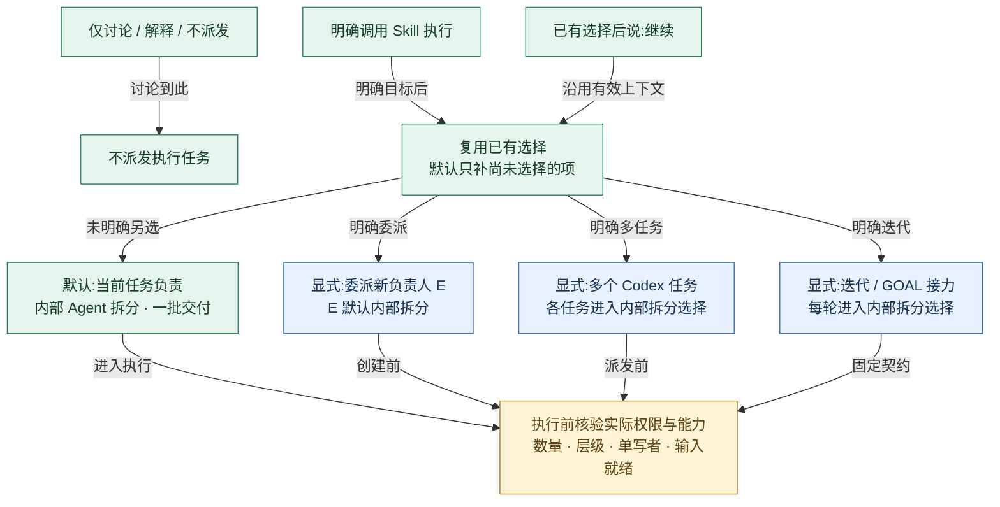
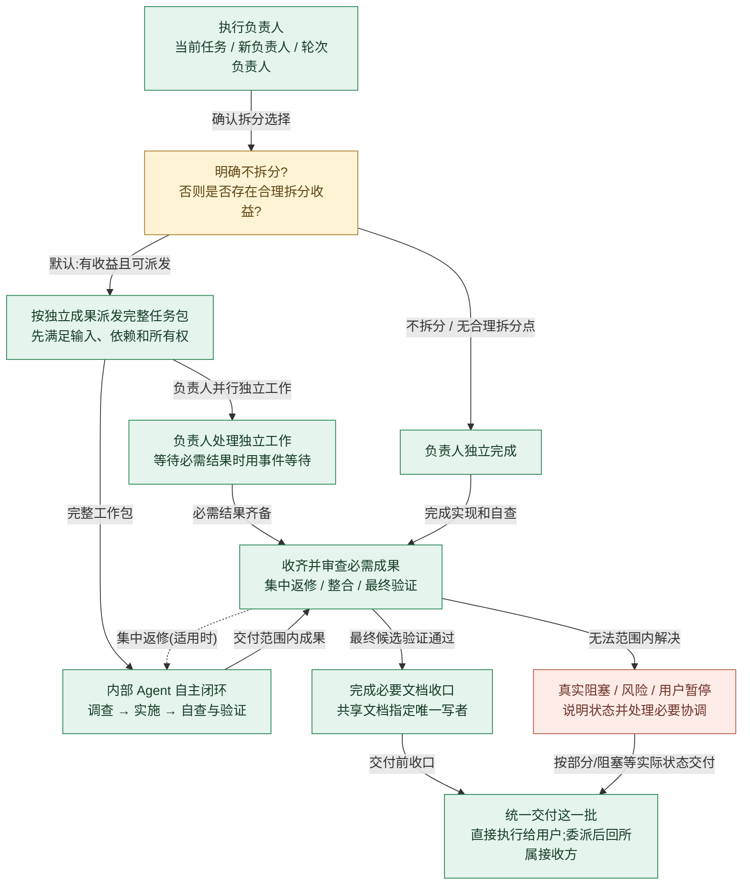
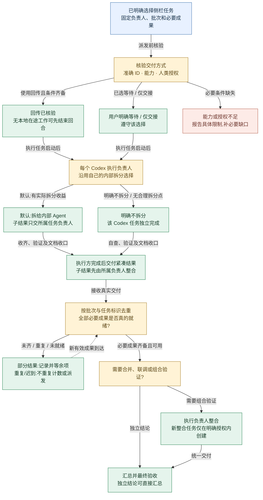
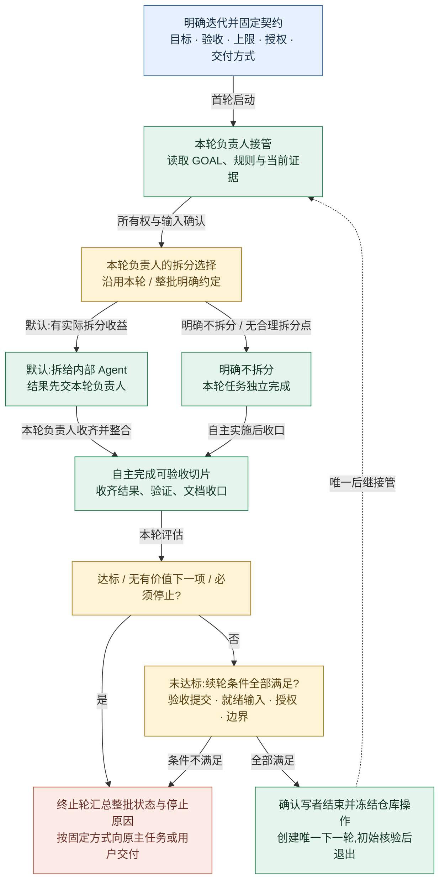

# orchestrate-tasks 判断与交付流程

默认由当前任务拆给内部 Agent,完成一个有界交付批次;委派新负责人、拆成多个 Codex 任务和 GOAL 迭代仅在用户明确选择时启用.

[打开四页可编辑流程图](overview.drawio).本文与图使用相同节点标识;规则真源仍是 [orchestrate-tasks/SKILL.md](../../orchestrate-tasks/SKILL.md).

## 怎么读

先看第 1 页选择入口,通常只需再看第 2 页.明确选择侧栏任务时看第 3 页,明确选择迭代时看第 4 页.委派决定谁负责,拆分决定如何组织工作,迭代决定是否多轮推进,可按明确授权组合.

| 你的输入 | 判断结果 |
| --- | --- |
| “先讨论一下,不要派发” | 只讨论,不启动执行编排 |
| “使用 $orchestrate-tasks 完成这个工作” | 当前任务负责,默认内部 Agent 拆分,一批交付 |
| “继续” | 沿用已有选择,不重置为默认 |
| “在本任务执行,不要拆分” | 当前任务独立完成,两种拆分承载都关闭 |
| “委派给一个新 Codex 任务” | 新负责人 E 默认内部拆分,原任务只做总控验收 |
| “委派,但不要拆分” | E 独立完成 |
| “拆成两个 Codex 任务” | 每个任务默认再拆给内部 Agent,各自收口后交当前负责人整合 |
| “拆成两个 Codex 任务,各任务不再拆分” | 两个任务各自独立完成,关闭的是内部拆分,不撤销已选择的两个任务 |
| “委派 E,再由 E 拆成两个 Codex 任务” | 仅按明确数量和层级授权创建一层;A/B → E → 原任务 |
| “按 GOAL 迭代” | 固定契约后有界接力;每轮默认内部 Agent 拆分 |
| “按 GOAL 迭代,每轮不要拆分” | 每轮负责人独立完成,不改变唯一后继和停止门禁 |
| “允许按需创建任务” | 只有权限含义,本身不改变已选承载或默认内部拆分 |

所有示例均需结合上下文中已明确的目标和范围.自然语言示例不是独立的权限凭据,任务创建、消息、Git、设备等仍按宿主规则核验.必要缺口补齐后才执行受影响动作.

拆分选择要绑定到具体负责人及范围.例如“拆成两个 Codex 任务,各任务不再拆分”保留外层两个任务,仅关闭它们的内部拆分;“本轮不拆分”与“整批不拆分”按各自范围生效,已有选择不因后续说“继续”而重置.

内部 Agent 承担局部调查和调试,向负责人返回紧凑成果与证据,有助于减少负责人上下文中积累的过程细节.是否减少总 token 取决于任务包、历史继承与协调成本,这里不宣称已实测节省.

## 01 输入与分支选择

先判断是否执行,沿用已有选择;未选择时由当前任务负责内部拆分.

绿色为默认路径.蓝色为显式选择.箭头是条件路由,不是时间刻度.委派、承载和迭代可组合,不是互斥模式.

实线表示条件和交付方向;虚线表示满足条件后的返修、再检查或后继接管,不表示无限循环.

**仅讨论 / 解释 / 不派发**: 此输入到讨论为止.本次阅读或绘制 Skill 逻辑也不等于执行业务编排.

**不派发执行任务**: 未要求执行编排时,不自动创建内部 Agent 或侧栏任务.

**明确调用 Skill 执行**: 例如:使用 $orchestrate-tasks 完成已确认的工作.先明确目标、范围、授权和验收.

**已有选择后说:继续**: 保留此前的负责人、拆分选择、承载与推进方式.用户明确变更的项目才更新.

**复用已有选择 / 默认只补尚未选择的项**: 单纯允许按需创建任务是授权,不等于选择侧栏承载.冲突或必要缺口先澄清,不重新询问已有授权.

**默认:当前任务负责 / 内部 Agent 拆分 · 一批交付**: 当前任务是执行负责人,可以直接调查、实施和整合.详见第 2 页.

**显式:委派新负责人 E / E 默认内部拆分**: 原任务成为纯总控.用户说委派后不拆分,E 独立完成;明确授权 E 拆成侧栏任务时才走一层下级聊天.

**显式:多个 Codex 任务 / 各任务进入内部拆分选择**: 按大型独立成果、就绪输入与明确所有权拆分.各负责人默认进入内部 Agent 拆分;用户明确该任务不拆分时,由该任务独立完成.当前负责人统一整合各任务成果,不另设无用收集者.

**显式:迭代 / GOAL 接力 / 每轮进入内部拆分选择**: 默认每轮新建 Codex 任务,每轮都沿用固定契约中的拆分选择:默认内部 Agent,或明确不拆分.可明确指定当前任务为首轮,但当前轮授权不推出后继权限.详见第 4 页.

**执行前核验实际权限与能力 / 数量 · 层级 · 单写者 · 输入就绪**: 适用于所有执行分支.侧栏创建、消息、Git 和设备各有授权边界;不擅建 worktree.缺工具或权限说明限制,不静默改承载.

证据:

- `orchestrate-tasks/SKILL.md:12-28`: 执行触发、默认值、选择沿用以及显式分支.
- `orchestrate-tasks/SKILL.md:30-46`: 角色、单写者、权限和按需引用.

## 02 默认执行:内部 Agent 与一次交付

负责人一次给出完整工作包,Agent 自主闭环;负责人收齐后整合、验证、文档收口.

本页是所有执行负责人的共同拆分选择:当前任务、受委派任务、多个 Codex 任务中的每个负责人及每轮迭代负责人都适用.普通子 Agent 是叶子,不递归套用这项默认.必要修复属于同一批,不自动续轮.

实线表示条件和交付方向;虚线表示满足条件后的返修、再检查或后继接管,不表示无限循环.

**执行负责人 / 当前任务 / 新负责人 / 轮次负责人**: 负责人承担调查、实施、协调、最终验证、整合和文档收口,不会因名称叫主任务而放弃执行.

**明确不拆分? / 否则是否存在合理拆分收益?**: 默认实施有收益的拆分,不能因为自己也能做就跳过.很小、强串行或无法划清写权时说明具体原因后直接完成.

**负责人独立完成**: 明确不拆分关闭内部与侧栏助手.没有合理拆分点时也可直接完成,不能为了凑数量创建工作.

**按独立成果派发完整任务包 / 先满足输入、依赖和所有权**: 一次给出目标、路径、范围、非目标、依赖、写权、授权、验收与停止条件.依赖输入未就绪时等待,不靠频繁消息补齐.

**内部 Agent 自主闭环 / 调查 → 实施 → 自查与验证**: 子 Agent 只向所属负责人交付.不创建侧栏任务或套用默认递归拆分;有界内部递归需要另有明确范围.

**负责人处理独立工作 / 等待必需结果时用事件等待**: 不持续查看过程或催促.有必需内部结果在途不能提前结束回合,也不能假设结束后会被内部 Agent 唤醒.

**收齐并审查必需成果 / 集中返修 / 整合 / 最终验证**: 先确认所有必需成果就绪、版本明确和写权归还.验收问题集中交原所有者修复,不把内部协调交回纯总控.

**完成必要文档收口 / 共享文档指定唯一写者**: 新功能、Bug 修复、性能和测试改进都检查必要记录.复用 bootstrap 文档契约及现有真源;不要求每次更新所有文档.只读任务列出建议,不得越权写入.

**统一交付这一批 / 直接执行给用户;委派后回所属接收方**: 交付状态、结论、修改范围、验证证据、必要文档以及未完成和在途项.完成一个有界批次后结束,不自动接力.

**真实阻塞 / 风险 / 用户暂停 / 说明状态并处理必要协调**: 只有无法自主解决的阻塞或授权缺口、有证据的冲突/风险及用户变更/暂停允许中途协调.失败或未知不能冒充完成.

证据:

- `orchestrate-tasks/references/subagents.md:3-21`: 默认内部拆分、完整工作包、叶子职责、事件等待与结果归属.
- `orchestrate-tasks/SKILL.md:52-61`: 交付前整合、回合结束与协调条件.
- `orchestrate-tasks/SKILL.md:63-81`: 共同文档职责及有界恢复规则.

## 03 显式侧栏任务:回传与整合

先核验交付路径,各任务向所属负责人回传;必要结果就绪后才整合或汇总.

返回路径:直接拆分 A/B → 当前负责人;委派 E → 原任务;委派再拆分 A/B → E → 原任务.不越级回传.

实线表示条件和交付方向;虚线表示满足条件后的返修、再检查或后继接管,不表示无限循环.

**已明确选择侧栏任务 / 固定负责人、批次和必要成果**: 单委派、多任务拆分和委派后一层拆分,均按用户明确选择与数量/层级授权创建.不强制增加收集聊天.

**核验交付方式 / 准确 ID · 能力 · 人类授权**: 默认回传需验证发送并开启接收任务新回合的能力及每条真实消息路径.创建任务权限不等于消息权限.

**回传已核验 / 无本地在途工作可先结束回合**: 派发后完成必要初始核验.仅剩侧栏结果时可结束回合,但整合责任保留;持有内部 Agent 未完成结果时不能提前结束.

**用户明确等待 / 仅交接 / 遵守该选择**: 等待用事件等待;仅交接不承诺通知原任务.不为未使用的回调强求消息授权.

**能力或授权不足 / 报告具体限制,补必要缺口**: 不得虚构后台唤醒,不得静默高频轮询或新增服务.不擅自切换交付方式.

**每个 Codex 执行负责人 / 沿用自己的内部拆分选择**: 多任务拆分后,每个任务仍是其分配成果的负责人,默认内部拆分.用户明确某任务或本批各任务不再拆分时,在指定范围内关闭.

**默认:拆给内部 Agent / 子结果只交所属任务负责人**: A 的 Agent 只向 A 交付,B 同理.各任务收齐并整合、验证、文档收口后,再向上级交付紧凑结果.

**明确不拆分 / 该 Codex 任务独立完成**: 该任务自己完成调查、实施、自查、验证和必要文档.没有合理拆分点时说明原因后也可直接完成.

**执行方完成后交付紧凑结果 / 子结果先由所属负责人整合**: 交付身份、状态、结论、范围、验证依据、文档、未完成与在途项.回调只尽力发送一次;发送未知不得盲目重发.

**按批次与任务标识去重 / 全部必要成果是否真的就绪?**: 收到不等于可用.版本与依据要明确,相关写者结束;失败、部分、取消或未知不能充当就绪依赖.

**部分结果:记录并等余项 / 重复/迟到:不重复计数或派发**: 不因部分回传催促正常执行者.重复消息不触发重复整合.缺失字段仅在反向消息授权内核实一次.

**需要合并、联调或组合验证?**: 当前执行负责人默认自行整合.纯总控不代改项目,返交原负责人;确需新整合任务必须已有相应明确授权.

**执行负责人整合 / 新整合任务仅在明确授权内创建**: 先确认输入、版本和写者就绪,处理集成问题、验证最终候选、自查并收口共享文档.

**汇总并最终验收 / 独立结论可直接汇总**: 创建成功、回合结束或单项测试通过不能替代完整成果验收.验收问题集中交对应负责人.

证据:

- `orchestrate-tasks/references/new-task-callbacks.md:3-23`: 回传归属、能力授权、一次发送及所有权释放.
- `orchestrate-tasks/references/new-task-callbacks.md:36-51`: 部分结果、真正就绪与重复/迟到处理.
- `orchestrate-tasks/references/mixed-carriers.md:3-11`: 一层混合承载以及 A/B、E 和原任务之间的交付路径.
- `orchestrate-tasks/references/new-tasks.md:23-30`: 依赖写者结束、回传和事件等待.
- `orchestrate-tasks/references/new-tasks.md:52-56`: 整合责任与新整合任务的授权条件.

## 04 显式迭代:GOAL 有界串行接力

每轮从项目资料接续;只有验收提交完成、写者结束且边界允许,才创建唯一后继.

每轮都进入拆分选择:默认拆给内部 Agent,明确不拆分则由本轮任务独立完成.选择按本轮或整批约定沿用,不逐轮重新询问.轮次之间仍串行,普通一批交付或已有 GOAL 文件都不会自动触发迭代.

实线表示条件和交付方向;虚线表示满足条件后的返修、再检查或后继接管,不表示无限循环.

**明确迭代并固定契约 / 目标 · 验收 · 上限 · 授权 · 交付方式**: 固定 GOAL 唯一路径、起止编号、首轮位置、后继及提交授权、实际指定预算.不自行填轮数或预算;缺必要项先补缺口.

**本轮负责人接管 / 读取 GOAL、规则与当前证据**: 默认新 Codex 任务;用户可指定当前任务为首轮.首轮安全确认 GOAL 初始缺失时按授权创建;后轮缺失先恢复核查.

**本轮负责人的拆分选择 / 沿用本轮或整批明确约定**: 拆分是轮内组织方式,与是否继续下一轮分开判断.默认内部拆分,明确不拆分时独立完成;不重置既定选择,不逐轮重复索取许可.

**默认:拆给内部 Agent / 结果先交本轮负责人**: Agent 只完成本轮分配成果,不持有迭代后继权;本轮负责人负责最终整合、验证和文档.

**明确不拆分 / 本轮任务独立完成**: 不创建内部助手,由本轮负责人完成切片.没有合理拆分点时也可说明原因后直接完成.这不改变续轮授权与停止规则.

**自主完成可验收切片 / 收齐结果、验证、文档收口**: 默认评估合理内部拆分;用户不拆分则独立完成.不将内部协调交回原主任务,不逐轮催促或汇报流水.

**达标 / 无有价值下一项 / 必须停止?**: 必须停止包括到达编号或预算边界、必需失败、缺输入、状态未知或用户要求.可范围内解决的普通失败由本轮处理.

**未达标:续轮条件全部满足? / 验收提交 · 就绪输入 · 授权 · 边界**: 续轮需完成获授权提交,真实后继授权及交付能力有效.当前执行授权不推出提交或后继权限;条件不足停止.

**确认写者结束并冻结仓库操作 / 创建唯一下一轮,初始核验后退出**: 冻结后不再读写仓库或运行测试/Git.后继只接固定契约与递增编号;动态事实从项目资料接续.创建未知先核查,不重复创建.

**终止轮汇总整批状态与停止原因 / 按固定方式向原主任务或用户交付**: 正常交棒不逐轮回调.达标或必须停止时才汇总;需要原主任务解决的真实阻塞可提前反馈.回传、等待、仅交接沿既定选择.

证据:

- `orchestrate-tasks/references/goal-relay.md:3-13`: 显式进入、固定契约、预算和首轮位置.
- `orchestrate-tasks/references/goal-relay.md:39-49`: 接管证据与 GOAL 初始化、恢复和维护.
- `orchestrate-tasks/references/goal-relay.md:53-68`: 收口提交、冻结、唯一后继、停止及整批交付.

## 按需文档读取

这些是条件读取关系,不是执行阶段或自动调用链.

| 条件 | 读取内容 | 条件不成立时 |
| --- | --- | --- |
| 派发内部 Agent | `references/subagents.md` | 不为未采用的内部承载预读 |
| 创建侧栏或整合任务 | `references/new-tasks.md` | 默认当前内部拆分不进入该分支 |
| 侧栏任务使用内部 Agent,或委派后再拆侧栏 | `references/mixed-carriers.md` | 普通内部拆分不加载 |
| 使用侧栏任务 | `references/new-task-callbacks.md` | 内部 Agent 不走侧栏消息路径 |
| 明确选择迭代 | `references/goal-relay.md` | 不因已有 GOAL 文件自动进入 |
| 内部自动选模或复评能力 | `references/model-selection.md` 和 `references/model-routing.json` | 已指定有效值或要求继承时不加载 |
| 所有执行方式交付前 | 按项目路由检查必要文档;通用职责引用 bootstrap-project-context 现有契约 | 不强制全部更新,不因该规则扩大写权 |

证据:

- `orchestrate-tasks/SKILL.md:38-48`: 最小任务包和条件读取入口.
- `orchestrate-tasks/SKILL.md:63-72`: 文档共同规则与只读边界.

## 证据与验证边界

本图核对的是当前指令文档,不是宿主运行时的自动路由实测.输入示例是对已核对规则的归纳,不表示已执行真实业务派发.

离线清点后以 source 模式扫描 `orchestrate-tasks/SKILL.md` 及上述五份执行分支文档,共 6 份 Markdown,扫描状态为 `ok`.未扫描 README、测试和模型策略;模型条件仅依据主入口已核对的引用说明.系统现有 Python 的 Markdown 解析依赖已通过探测;Skill 自带虚拟环境缺少该分支依赖,未安装或改变环境.

内部索引位于 `diagram-codebase/tools/local/scans/84f6751ad2bba4832722/index.json`,仅用于本机取证,不属于交付依赖.查询了入口标题与引用;定向读取子 Agent、侧栏创建、混合承载、回调和 GOAL 接力的相关条件.未分析业务项目,未启动真实编排,未修改 Skill 规则.

图文结构由 `check_diagram.py` 检查;语义逐项对照上述证据,不以结构检查代替业务运行验证.实际 draw.io 画布与 Mermaid 渲染的视觉效果未复核.
